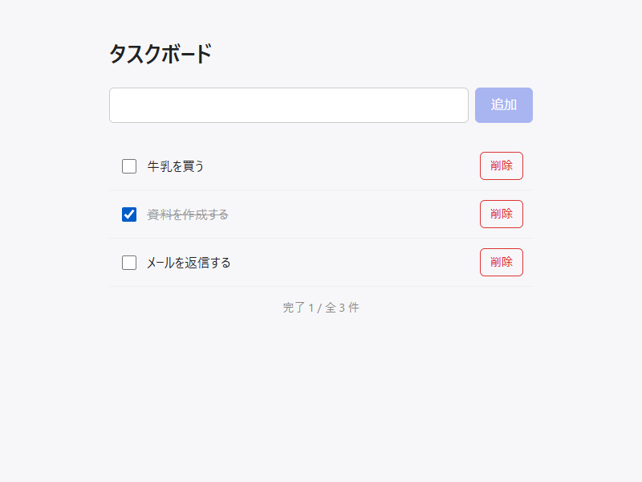

# task-board2

シンプルなタスクボードアプリです。React と Vite で作っています。

**公開ページ: https://timmy-0123bot.github.io/task-board2/**



## 機能

- テキストを入力して、タスクを追加する（Enter キーでも追加できる）
- チェックボックスで、完了・未完了を切り替える
- 完了済みのタスクをグレーと取り消し線で表示する
- タスクを削除する
- 完了数と全体の件数を表示する
- ページを再読み込みしても、タスクが残る

タスクは、使っているブラウザの localStorage に保存されます。サーバーには送信されないため、別のブラウザや端末とは共有されません。ブラウザの閲覧データを消すと、タスクも消えます。

## 使用技術

- [React](https://react.dev/) 19
- [Vite](https://vite.dev/)
- [oxlint](https://oxc.rs/)（リンター）
- GitHub Actions と GitHub Pages（自動公開）

## 手元で動かす

[Node.js](https://nodejs.org/) が必要です（開発では v24 を使っています）。

```bash
git clone https://github.com/Timmy-0123bot/task-board2.git
cd task-board2
npm install
npm run dev
```

起動したら、ブラウザで http://localhost:5173 を開きます。止めるときは、ターミナルで `Ctrl + C` を押します。

## コマンド

| コマンド | 内容 |
| --- | --- |
| `npm run dev` | 開発サーバーを起動する（http://localhost:5173） |
| `npm run build` | 公開用にビルドする（`dist/` に出力） |
| `npm run preview` | ビルドした結果を確認する（http://localhost:4173/task-board2/） |
| `npm run lint` | リンターでコードをチェックする |

## ディレクトリ構成

```
task-board2/
├── .github/workflows/deploy.yml  # GitHub Pages への自動公開
├── docs/                         # README 用の画像
├── public/                       # そのまま公開するファイル（ファビコン）
├── src/
│   ├── App.jsx                   # タスクボード本体
│   ├── App.css                   # タスクボードのスタイル
│   ├── index.css                 # 全体の基本スタイル
│   └── main.jsx                  # エントリーポイント
├── index.html
└── vite.config.js
```

## 公開の仕組み

`main` ブランチにプッシュすると、GitHub Actions が自動で動きます。リンターでのチェックとビルドを行い、GitHub Pages に公開します。反映までは 1 分ほどかかります。

公開ページは `/task-board2/` 以下にあるため、`vite.config.js` の `base` にこのパスを設定しています。ビルドとプレビューのときだけ設定されるので、開発サーバーは `/` のまま開けます。
